<h1 align="center">Hi, I'm Pedro Ian 👋</h1>

  

  
  
  

## About me

I'm 20, based in Brasília, and in my 6th semester of Software Engineering at the University of Brasília (UnB). I build full-stack apps with TypeScript (NestJS, Next.js, React, Prisma) and Python.

From July 2025 to February 2026 I worked at CJR, UnB's computer science junior enterprise, as a full-stack developer and sales advisor. I built web apps in Scrum teams and ran Google Ads campaigns to bring in clients, so I think about what the code does for the business as much as how it's written.

I'm looking for opportunities to work on real products and keep growing on both the front-end and the back-end.

## 🏆 Datathon winner

**[Datathon Proteção Inteligente, BB Digital Week 2026](https://github.com/pedroiaan/datathon-protecao-inteligente)** · BB Seguros and Ibmec Brasília

I led team Varetas (5 people) to first place with an explainable recommendation engine for home insurance. For each customer and property, it decides eligibility, the plan, the coverages and the price range, and explains why.

- **Rules, not a black box:** a Python rules engine with no machine learning. Every decision has a written rule, a source and a test, with 155 automated tests running on GitHub Actions.
- **Less effort for the customer:** 2.75 questions on average instead of about 20 quote fields (86% less), and 81% of cases resolved without a manager.
- **Full product:** a customer app and a manager dashboard in Expo (React Native), plus a FastAPI API, all fed by the same output from the engine.

## 🚀 Projects

**[Guardiões da Universidade](https://github.com/fga-eps-mds/2025.2-Valhalla)** · Next.js, NestJS, Prisma 
A platform where UnB's academic community can report problems and find guidance, outside the official channels. In a team of 12, I built the account flow (sign-in, password reset by email, password strength check, profile editing and deletion), the reports module in NestJS with its tests, the search filters, the admin page and the CI pipeline.

**[Professor reviews](https://github.com/PT-CJR-FUI-COM-A-CARA/backEnd)** · NestJS, Prisma, React · CJR 
A site where students rate professors and read reviews before enrolling. I was the main back-end contributor: data model, JWT authentication with bcrypt-hashed passwords, and the APIs for users, professors, courses, reviews and comments.

## 🛠️ Tech stack

<table>
  <tr>
    <td><b>Languages</b></td>
    <td></td>
  </tr>
  <tr>
    <td><b>Front-end and mobile</b></td>
    <td></td>
  </tr>
  <tr>
    <td><b>Back-end and data</b></td>
    <td></td>
  </tr>
  <tr>
    <td><b>Tools</b></td>
    <td></td>
  </tr>
</table>

## 📊 GitHub stats

  <picture>
    <source media="(prefers-color-scheme: dark)" srcset="https://raw.githubusercontent.com/pedroiaan/pedroiaan/output/stats-dark.svg" />
    
  </picture>
  <picture>
    <source media="(prefers-color-scheme: dark)" srcset="https://raw.githubusercontent.com/pedroiaan/pedroiaan/output/top-langs-dark.svg" />
    
  </picture>

  <picture>
    <source media="(prefers-color-scheme: dark)" srcset="https://streak-stats.demolab.com?user=pedroiaan&theme=tokyonight&hide_border=true" />
    
  </picture>

  <picture>
    <source media="(prefers-color-scheme: dark)" srcset="https://raw.githubusercontent.com/pedroiaan/pedroiaan/output/snake-dark.svg" />
    
  </picture>

